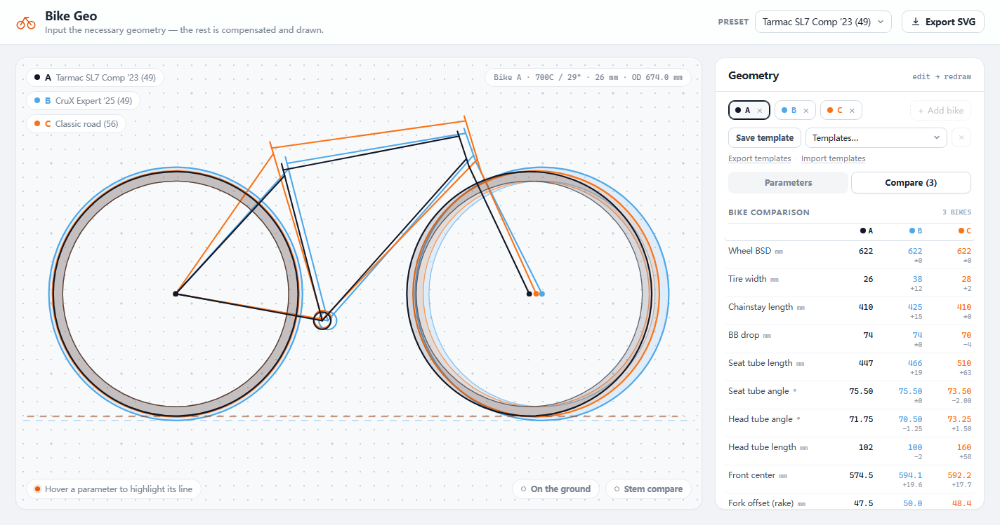
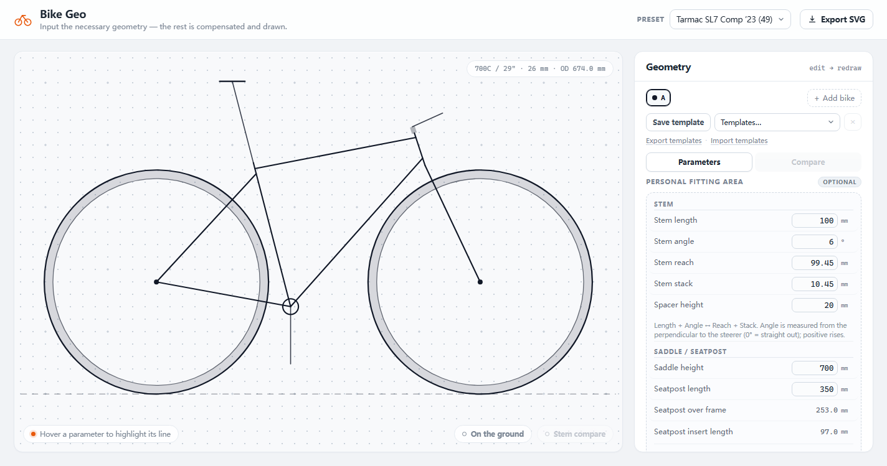
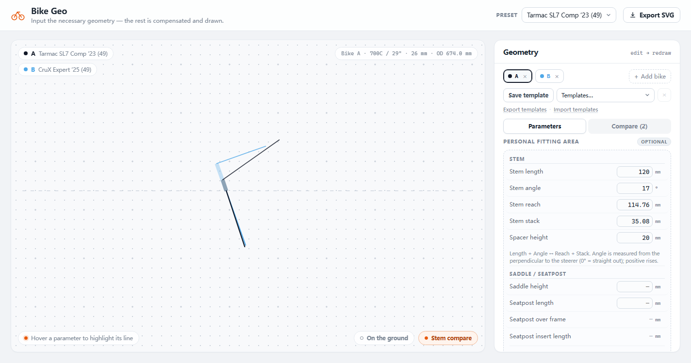

# Bike Geo

参数化自行车几何绘图工具：输入一台车的必要几何数据，程序按标准几何关系推导
Reach / Stack / Wheelbase / Trail 等结果，并在点阵纸风格的画布上绘制车架侧视图。

纯 HTML / CSS / JavaScript，无框架、无依赖、无构建步骤；双击即可离线使用。



## 功能

- **参数化车架几何**：11 项必要输入，自动推导 12 项结果
  （Reach / Stack / Stack-Reach 比、Wheelbase、Trail、有效上管、轮胎外径等）
- **最多 3 台车彩色叠画对比**（黑 / baby 蓝 / 活力橙），带数值差表；
  轮胎环带按车色淡染
- **两种对齐基线**：后轴对齐 / 地面线对齐
- **Personal Fitting Area（可选）**：把立 Length/Angle/Reach/Stack 双向换算，
  Spacer Height 垫圈高度，Saddle Height + Seatpost Length 派生
  Seatpost Over Frame / Insert Length，Crank Length 垂直绘制；留空不影响车架几何
- **Stem Comparison Mode**：两台车按头管顶端对齐，放大头管/垫圈/把立区域；
  Spacer Height 以该车颜色淡色带绘制，把立叠加在垫圈上方，便于比较把立设定
- **自定义模板**：保存在本机浏览器，可整体导出为 JSON / 在新设备导入
- **悬停联动标注**：悬停参数行，对应线条高亮并显示尺寸
- **导出矢量 SVG**：可在 Illustrator / Figma / CAD 中继续编辑
- **深链**：`?preset=crux&compare=crux,classic&align=ground`





## 快速开始

**方式一（最省事）**：直接双击 `bike_geo.html`（单文件版，所有 CSS/JS 已内联）。

**方式二（源码版）**：双击 `index.html`，或在本目录启动静态服务器：

```sh
python -m http.server 8000
# 打开 http://localhost:8000
```

建议使用较新的 Chrome / Edge / Firefox / Safari。界面为英文，完整中文说明见
[README.txt](README.txt)。

## 测试

需要 Node.js 18+（仅测试需要；网页本身不需要）：

```sh
node tests/geometry.test.js
node tests/render.test.js
node tests/datasource.test.js
node tests/templates.test.js
```

浏览器交互测试（可选，需要 Chrome 或 Edge）：

```sh
npm run test:browser
```

## 项目结构

```
index.html          源码版入口
bike_geo.html       单文件版（全部 CSS/JS 内联，可直接发送）
css/styles.css      界面与点阵纸样式
js/geometry.js      几何求解器 + 参数目录 + 可选 fitting 模型
js/render.js        SVG 线稿与标注渲染、SVG 导出
js/templates.js     模板导出/导入格式（纯函数，可测试）
js/datasource.js    预留的在线车型数据适配器
js/app.js           界面交互
tests/              单元测试
tests/browser/      浏览器交互测试
docs/               开发者文档与截图
README.txt          完整中文使用说明
bike_geo简介.txt     面向车架/产品同行的产品简介
需求.txt             V1.1 需求记录与实现备注
```

## 数据与隐私

- 完全离线运行，无统计、无网络请求；
- 模板与 Personal Fitting 数据默认只保存在本机浏览器 localStorage；
- 只有用户主动导出模板 JSON 时，数据才会写入文件，由用户自行决定分享；
- 在线车型导入按钮为预留功能，当前不可用。

## 版本

Bike Geo v1.1 · 2026-10
