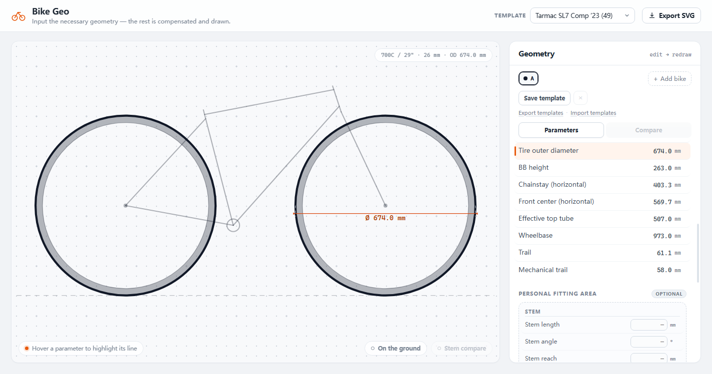
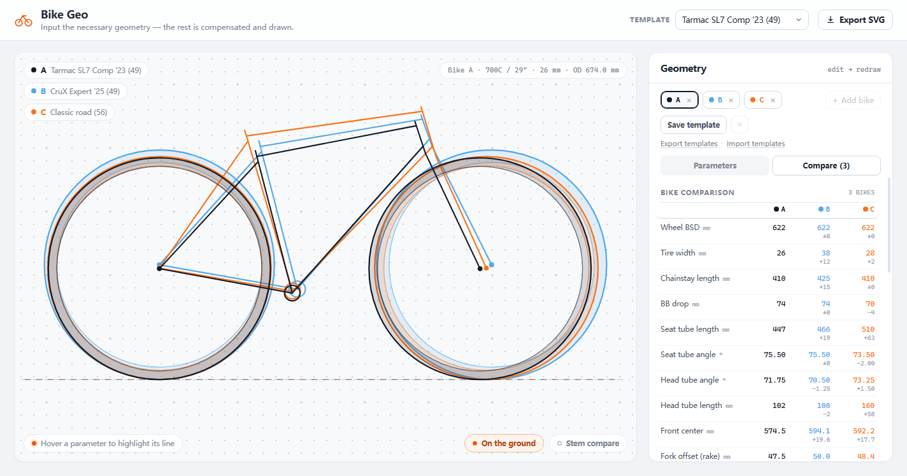

# Bike Geo — developer notes

> Developer documentation. The Chinese user/share guide lives in
> [`../README.txt`](../README.txt).

A single-page parametric bicycle geometry sketch with a comparison mode.


**One function, done well:** you enter the *necessary* numbers of a bike, the
app derives the rest (reach, stack, wheelbase, trail, effective top tube, …)
and draws the frame as clean line art on dotted engineering paper. Up to
**three bikes** can be entered at once; each frame is
drawn in its own colour (A = black, B = baby blue, C = vivid orange) on top of
the others, the tyre band between the two wheel circles is tinted with the
bike colour, and a comparison table lists values and deltas. Hover any
parameter row and the matching line lights up on every bike, with the selected
bike's dimension drawn. Edit any input and the drawing redraws live.

No framework, no build step, no npm install — plain HTML/CSS/JavaScript.

## Run

From the project root, double-click `index.html` (works from `file://`), or
serve the folder:

```sh
python -m http.server 8000
# http://localhost:8000
```

## The parameter model

Eleven inputs are enough to pin the whole side view down:

| Input | Unit |
| --- | --- |
| Wheel BSD (bead seat diameter, 622 = 700C/29", 584 = 650B) | mm |
| Tire width (cross-section width = side-wall height) | mm |
| Chainstay length (BB center → rear axle) | mm |
| BB drop | mm |
| Seat tube length (BB center → top) | mm |
| Seat tube angle | ° |
| Head tube angle | ° |
| Head tube length | mm |
| Front center (BB center → front axle) | mm |
| Fork offset / rake (front axle → steering axis, perpendicular) | mm |
| Fork length A2C (along the steerer, rake ignored) | mm |

Reach, stack and wheelbase are **results**, not inputs. Everything else is
derived by `js/geometry.js`:

- tire outer radius and **tire outer diameter** — the tire model is
  `OD = BSD + 2 × tire width` (the tire cross-section width is the side-wall
  height, one side on each side of the BSD). So **+1 mm of tire width adds
  +2 mm to the outer diameter**: 700C (622) × 26 mm → **674 mm**;
  650B (584) × 47 mm → **678 mm**. Hovering the "Tire outer diameter" row draws
  the diameter across the wheel.

  
- **reach, stack, stack/reach ratio** — placing the front axle from the front
  center + BB drop, offsetting the steering axis from the axle by the rake, and
  putting the head-tube bottom one **A2C fork length** along the steerer from the
  axle projection gives the head tube; its top (plus head-tube length) relative
  to the BB is reach/stack. The straight axle-to-head-tube-bottom distance is
  `√(A2C² + rake²)`.
- **wheelbase** — the two horizontal projections:
  `√(chainstay² − bbDrop²) + √(frontCenter² − bbDrop²)`.
- BB height, chainstay horizontal, front-center horizontal, effective top tube
- **standover height** — ground to top tube, measured at
  `x = bb.x + 125 mm` (Specialized convention). The top-tube line is the
  drawing's seat-tube/head-tube junction line:
  `y = ttSeat.y + (x − ttSeat.x) · (ttHead.y − ttSeat.y) / (ttHead.x − ttSeat.x)`.
- **trail** and **mechanical trail** from the steering-axis geometry
- stack / reach ratio (already listed above)

The derivation (world coordinates, rear axle at origin):

```
frontAxle        = bb + (√(frontCenter² − bbDrop²), +bbDrop)
steering axis    = line through frontAxle − rake·n, direction u = (−cos HTA, sin HTA)
                   with n = (sin HTA, cos HTA)
headTubeBottom   = (frontAxle − rake·n) + forkLengthA2C·u
forkLengthStraight = √(forkLengthA2C² + rake²)
headTubeTop      = headTubeBottom + headTubeLength·u
reach / stack    = headTubeTop − bb
standover        = topTubeY(bb.x + 125) − groundY
wheelbase        = frontAxle.x
```

The formulas are the standard bicycle-geometry ones and the solver is checked
against published geometry charts for two real bikes (Specialized Tarmac SL7
Comp 49 and CruX Expert 49, from Bike Insights).

## Personal fitting (optional)

The Personal Fitting Area records rider-contact setup without touching the
frame solve. Every field is optional (`null` when empty); blank data is not
drawn, not measured and not compared. `js/geometry.js` exports
`FITTING_FIELDS`, `FITTING_RULES`, `EMPTY_FITTING`, `solveFitting()` and the
stem conversion helpers.

Stem: the angle is measured from the perpendicular to the steerer (0° =
straight out, positive rises along the steerer):

```
stem reach = L · cos(a)      // perpendicular to the steerer
stem stack = L · sin(a)      // projection along the steerer
L = √(reach² + stack²)
a = atan2(stack, reach)
```

Length + Angle and Reach + Stack are two representations of the same stem. The
UI keeps whichever pair was edited last as the basis; completing a pair fills
the other pair. `solveFitting()` returns the synced four values and the drawing
points (stem clamp, stem end, saddle top, crank end).

Spacer height raises the stem clamp along the steerer; it does not change the
stem's own reach/stack:

```
stem clamp   = headTubeTop + spacerHeight · steererDirection
spacer band  = [headTubeTop, stem clamp]
```

Saddle height is measured along the seat tube from the BB center:

```
seatpost over frame  = saddleHeight − seatTubeLength
seatpost insert      = seatpostLength − seatpostOverFrame
```

Drawing parts: `fit-spacer` (a thick, low-opacity spacer stack), `fit-stem`,
`fit-seatpost`, `fit-saddle` (short horizontal marker at the saddle top) and
`fit-crank` (vertical line down from the BB). They are drawn per bike in the
bike colour, included in the view-box bounds and in the standalone SVG export.
Fitting values are stored in templates and exported with them; they never feed
back into reach / stack / wheelbase.


## Interactions

- **Tune** — every necessary input is editable; the drawing and all compensated
  values update on each keystroke. Values are clamped to sane ranges on blur.
- **Hover** — hovering (or tab-focusing) a parameter row highlights the related
  tubes/wheels on every bike (in that bike's colour) and draws the selected
  bike's dimension or value tag: wheelbase, chainstay, BB drop, seat tube,
  head/seat tube angles, head tube, reach/stack, trail, mechanical trail, rake,
  effective top tube, … Everything else fades so the compared lines stand out.
- **Compare** — up to 3 bikes. `+ Add bike` appends the next unused built-in
  template (or a copy), the new bike is drawn over the others in its own colour,
  and the **Compare** view lists every parameter for A/B/C with the delta versus
  Bike A. Tabs switch which bike the Parameters view edits; `×` removes a bike.
- **On the ground** — the button at the bottom-right of the canvas switches the
  overlay baseline: rear axle (default, best for comparing frame geometry) or
  the ground line / lowest point of the wheels (shows the real ride-height
  difference caused by wheel and tyre size). `render(..., { align: 'ground' })`
  shifts each bike up by its tyre radius; `Render.alignGeometries()` exposes the
  same helper.
- **Stem compare** — enabled with at least two bikes. `align: 'headtube'`
  translates every bike so its head-tube top lands on the world origin
  (`Render.alignGeometries(..., 'headtube')`); fitting points are translated
  with the frame. The renderer keeps the full bike scene but zooms the view box
  to the head-tube / stem area (`stemFocusBox`) so spacer differences stay
  readable, and draws a dotted `stem-guide` through the aligned head-tube tops.
  Spacer stacks are thick low-opacity bands (`fit-spacer`) and the stem starts
  at the top of the spacer. Hovering `spacerHeight` draws its dimension tag.
- **Templates** — one Template picker (top bar) merges two sources:
  - **Built-in templates** (`builtin:<preset-id>`, read-only): generated from
    `Geo.PRESETS`; loading one replaces the 11 frame inputs and preserves the
    bike's current Personal Fitting. Delete is disabled and their names are
    reserved.
  - **User templates** (`user:<name>`, stored in `localStorage` key
    `bikegeo.templates.v1`): full snapshots of frame inputs + Personal Fitting;
    `Save template` creates/overwrites one, `×` deletes it.
  Each bike stores `templateId` (or `null` for Custom). Editing an input clears
  the link (Custom). `Custom` in the picker detaches without changing values.
  Falls back to session-only memory if storage is unavailable. Templates never
  leave the browser by themselves.
- **Template export / import** — `Export templates` downloads only the user
  templates (built-ins are shipped with the app) as
  `bikegeo-templates-YYYYMMDD.json`; `Import templates` reads such a file through
  a hidden file input and merges it. A name conflict asks via `confirm()`: OK
  overwrites, Cancel keeps both by adding `(2)`, `(3)`, …. Imports colliding with
  a built-in name are renamed automatically. The pure format helpers live in
  `js/templates.js` (schema version 1).
- **Personal Fitting Area** — optional stem (Length/Angle ⇄ Reach/Stack),
  Spacer height, Saddle height + Seatpost length (with derived over-frame /
  insert length) and Crank length. Hovering a fitting row highlights its overlay
  on every bike; filling values adds them to templates, the compare table and
  the drawing. They never change frame geometry.
- **Built-in templates** — Tarmac SL7 Comp '23 (49), CruX Expert '25 (49),
  Classic road (56), 650B gravel (47 mm). They live in the same Template picker
  as user templates but are read-only; editing switches the bike to "Custom".
- **Deep links** — `?preset=crux`, `?compare=crux,classic`, `?param=stack`,
  `?param=spacerHeight`, `?view=params|compare`, `?align=ground|stem` (handy for
  sharing a view and for visual QA).
- **Export SVG** — downloads the current drawing as a standalone SVG (vector,
  all bikes with their comparison colours, dotted paper included, opens in
  Illustrator/Figma/CAD).




## Portable templates

Templates are local by default; `js/templates.js` is a DOM-free, unit-tested
module that turns **user templates** into a portable document (built-in
templates are not exported):

```json
{
  "app": "Bike Geo",
  "schemaVersion": 1,
  "exportedAt": "2026-10-27T09:00:00.000Z",
  "templates": [
    { "name": "Road fit", "presetId": "tarmac",
      "forkLengthMode": "a2c",
      "inputs": { "bsd": 622, "…": "…" },
      "fitting": { "stemLength": 100, "…": "…" } }
  ]
}
```

`forkLengthMode: "a2c"` marks the fork-length convention. Older templates from
the straight-line era are migrated when read: the stored value is converted to
A2C with `√(straight² − rake²)`.

`parseImport()` accepts either the object or a bare array of templates; it
rejects invalid JSON, newer schema versions and files without valid templates,
and skips malformed entries. `uniqueName()` resolves conflicts. Export/import
uses `Blob` + anchor download and `FileReader` respectively — no server, no
network.

## Reserved: online geometry import

`js/datasource.js` is a tiny adapter registry and **ships empty by design**.
The Bike Insights adapter is registered with `status: "planned"` and a
`fetchGeometry()` that rejects. Enabling real import later means filling in that
one function; nothing else changes:

```js
BikeGeoData.register({
  id: 'bikeinsights',
  label: 'Bike Insights',
  status: 'available',
  fetchGeometry: async ({ url }) => ({
    name: 'Tarmac SL7 Comp 49',
    inputs: { bsd: 622, tireWidth: 26, frontCenter: 574.5, /* … */ },
    meta: { url }
  })
});
```

The solver accepts partial input, so a source that only publishes some fields
still works — the rest is compensated and clamped.

## Tests

The project is built tracer-bullet style: the solver and the renderer are pure
functions with tests, then the UI is wired on top. The tests need Node.js 18+
(the app itself needs nothing but a browser).

```sh
npm test
# or, without npm:
node tests/geometry.test.js
node tests/render.test.js
node tests/datasource.test.js
node tests/templates.test.js
```

- `tests/geometry.test.js` — reference-bike fixtures, geometric consistency
  (wheelbase, seat tube, steering-axis trail identities), A2C ↔ straight fork
  conversion, standover point/offset, clamping, optional fitting conversions /
  derived seatpost values / fit points.
- `tests/render.test.js` — scene parts, view box containment (single + multi
  bike), colour groups, hover highlighting + dimensions, fit overlays, spacer
  bands, head-tube alignment and magnified (unfiltered) stem view, ground
  alignment shifting, standalone SVG export, "no NaN coordinates", re-render
  after tuning.
- `tests/datasource.test.js` — adapter registry contract and reserved adapter.
- `tests/templates.test.js` — export document shape, import validation,
  round-trip, conflict-name helper and date-stamped file names.

Optional end-to-end interaction test (drives the real page through the Chrome
DevTools Protocol: edit → recompute → redraw, hover → highlight, clamping,
built-in/user template switching, add/select/remove bikes, comparison table deltas, fitting
pair conversion, template save/export/import round-trip). Needs Chrome or Edge
installed:

```sh
npm run test:browser
```

## Files

Paths relative to the project root:

```
README.txt          Chinese user guide (what friends get)
index.html          page shell (open this)
bike_geo.html       single-file build: all CSS/JS inlined, send as one file
css/styles.css      dotted-paper canvas, panel, drawing styles
js/geometry.js      solver + parameter catalogue + optional fitting model
js/render.js        SVG line-art + annotation renderer, standalone SVG export
js/datasource.js    reserved online-geometry adapter registry
js/templates.js     portable template export/import format (pure, tested)
js/app.js           UI wiring (edit → solve → draw, hover → highlight,
                    bike tabs, comparison table, fitting area, templates)
tests/              tracer-bullet unit tests
tests/browser/      optional browser interaction test + runner
docs/DEVELOPER.md   this file
docs/preview.png    app screenshot used by the docs
docs/tire-od.png    tire outer-diameter annotation screenshot
docs/ground-alignment.png  ground-line alignment screenshot
docs/fitting.png    personal fitting overlays + optional fields screenshot
docs/stem-comparison.png  stem comparison mode screenshot
```
